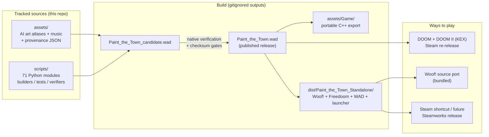

# Paint the Town: Toronto

A nine-map Toronto paintball campaign for classic DOOM — built entirely from
original, AI-assisted art, music and code, playable both as a DOOM mod and as a
fully **standalone game** (no DOOM purchase required).

You play a paintballer touring nine real Toronto landmarks — the Royal Ontario
Museum, Queen's Park, Sankofa Square, Nathan Phillips Square, Union Station,
Scotiabank Arena, Rogers Centre, the Toronto Islands and the Toronto Zoo —
against nineteen animal paintball rivals. Grab the Portal Key in each venue and
press Spacebar at the gold EXIT panel. Everything is paint: no blood, no gore,
a PG-13 arcade aesthetic.

**Current release:** `Paint_the_Town.wad`
SHA256 `7f8d824d400373a314763c6ffb8aa477147e0285e909db7335bad5a045db3499`
(1,718 lumps). Releases are distributed as Git tags / GitHub release assets;
`.wad` files are not tracked in the repository.

## How everything fits together



## Quick start — playing the game

| Method | Command / steps |
| --- | --- |
| **Standalone package** (recommended) | `& '.\dist\Paint_the_Town_Standalone\Paint the Town.bat'` — auto-detects an owned DOOM.WAD, else uses bundled Freedoom. Fully self-contained. |
| **Official KEX re-release** | `& "C:\Program Files (x86)\Steam\steamapps\common\Ultimate Doom\rerelease\doom.exe" -file "$PWD\Paint_the_Town.wad"` (requires owning DOOM + DOOM II on Steam) |
| **Bundled Woof! directly** | `dist\...\port\woof.exe -iwad ..\iwad\freedoom1.wad -file ..\Paint_the_Town.wad -save ..\saves` |
| **Steam library shortcut** | Add `port\woof.exe` as a non-Steam game with launch options `-iwad ..\iwad\freedoom1.wad -file ..\Paint_the_Town.wad -save ..\saves`; artwork in `steam_grid\` |

Always start a **NEW GAME** after upgrading the WAD — old saves reference old
layouts. GZDoom is **not** supported (it rejects the 2024 DeHackEd spec).

## Rebuilding from source

```powershell
py -B -m pip install -r requirements.txt   # Pillow, NumPy, Shapely
py -B scripts\prepare_venue_art.py         # normalize AI atlases into sprites
py -B scripts\build_expansion.py           # build + validate the candidate WAD
py -B -m unittest discover -s scripts -q   # regression suite
```

Publishing to `Paint_the_Town.wad` is gated behind checksum-bound **native
verification** in the KEX engine — see [docs/BUILD.md](docs/BUILD.md). The
builder reads palette/texture directories from the Steam Ultimate DOOM IWAD
(override with the `DOOM_IWAD` environment variable) and uses the ZDBSP node
builder in `tools\zdbsp\` (gitignored; source recorded in
`tools\nodebuilder.json`).

## Repository map

| Path | What it is | Tracked? |
| --- | --- | --- |
| `scripts/` | All builders, content definitions, tests and native verifiers | ✅ |
| `assets/` | Original AI art atlases, music, provenance — the irreplaceable sources | ✅ |
| `assets/Game/` | Portable export for a C++ reimplementation (regenerated by `export_game_assets.py`) | ❌ |
| `steam/` | Steamworks build scripts, store assets, setup walkthrough | ✅ |
| `docs/` | Project documentation (you are here) | ✅ |
| `dist/` | Standalone package + zip (regenerated by `build_standalone.py`) | ❌ |
| `runtime_validation/` | Checksum-bound native test evidence (regenerated by `verify_*.py`) | ❌ |
| `tools/` | Downloaded ZDBSP, Woof!, Freedoom binaries | ❌ |
| `mod_preview/` | Listing images (regenerated by `build_mod_previews.py`) | ❌ |
| `*.wad` | Candidate, release and protected legacy WADs | ❌ (tags/releases) |

## Documentation

- **[docs/BUILD.md](docs/BUILD.md)** — the full build → verify → publish →
  package pipeline, with every gate explained.
- **[docs/SCRIPTS.md](docs/SCRIPTS.md)** — what each of the 71 Python scripts
  does, and how the core modules depend on each other.
- **[docs/STANDALONE.md](docs/STANDALONE.md)** — how a DOOM mod became a
  standalone game: IWADs vs PWADs, what Freedoom is, why Woof! ships, the
  smart launcher and Steam setup.
- **[docs/HISTORY.md](docs/HISTORY.md)** — WAD lineage from the three-map
  prototype to today's release, checksums, and hard-won engine findings.
- `assets/AGENTS.md` + `assets/IMPLEMENTATION.md` — contracts for porting the
  game content to another engine.
- `steam/SETUP-STEAMWORKS.md` — numbered walkthrough for the Steam release.

## Gameplay summary

- **Weapons:** mallet (melee), starter, pump and automatic paintball markers —
  one shared PAINTBALLS pool (400 capacity, 800 with backpack); the pump needs
  7 paintballs per burst.
- **Rivals:** 19 types (raccoon gunner everywhere + 2 exclusives per venue),
  with tiered markers by size and original synthesized sounds.
- **Progression:** find the octagonal metal Portal Key, activate the gold EXIT
  panel (fairy dust before activation, glowing beam after), ride the pixel-art
  Toronto overworld between venues, finish at the Zoo for the victory screen.
- **Pickups:** all original paint-kit art — paint splashes/buckets (health),
  vials/shards (bonuses), vests (armour), pods/cases (ammo), hopper backpack,
  and the Paint Surge (super-charge orb). The campaign has no hidden "secret"
  areas.

## Licensing / provenance notes

- All art, music and sounds are original project work (AI-assisted, reviewed,
  with SHA-256 provenance in `assets/art_sources/*/provenance.json`). No stock
  DOOM assets, commercial recordings or third-party sprites ship in the WAD.
- The standalone package bundles **Woof!** (GPLv2+) and **Freedoom Phase 1**
  (BSD) with their licenses and source links — see
  [docs/STANDALONE.md](docs/STANDALONE.md).
- ZDBSP (GPLv2) is a build-time tool only; it is not embedded in the WAD.
