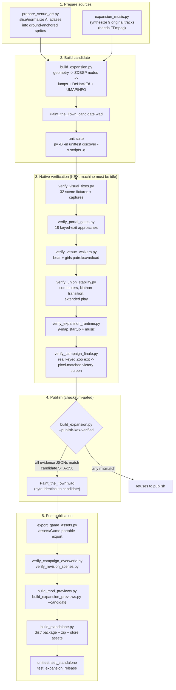
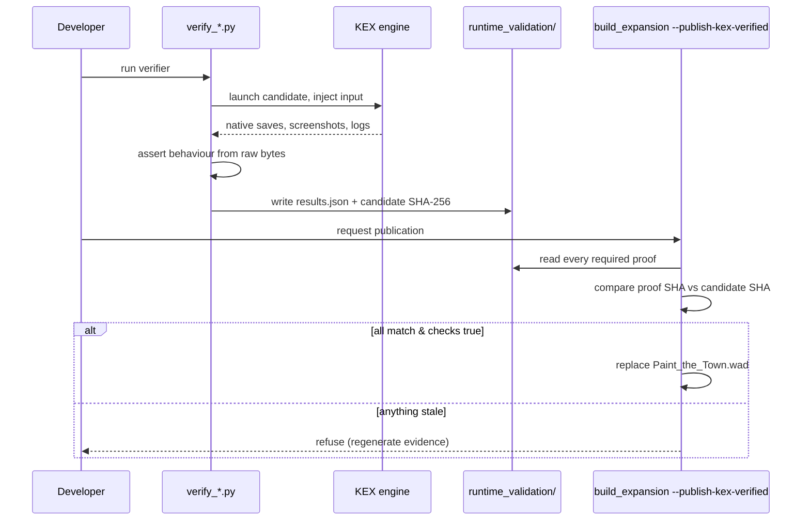

# Build, Verification and Publication Pipeline

This project treats the WAD like a software release: a **candidate** is built
and unit-tested, then proven in the **real game engine** (native verification),
and only then **published** — every piece of evidence is bound to the
candidate's SHA-256 so stale proofs can never bless a new build.

All commands run from the workspace root with `py -B` (Python 3.13; `-B`
avoids `.pyc` clutter).

## The big picture



## 1. Prepare sources

| Command | Output |
| --- | --- |
| `py -B scripts\prepare_venue_art.py` | `assets\art_sources\polish\sprites\` — every sprite sliced from the AI atlases, background-keyed, scaled to reviewed native dimensions, bottom-centre ground-anchored, recorded in `normalization.json` (SHA-256 per sprite). |
| `py -B scripts\prepare_expansion_art.py` | Cleaned NPC sheets (historical; rarely re-run). |
| `py -B scripts\expansion_music.py` | Nine Ogg/MIDI pairs + provenance in `assets\music\paint_the_town\`. Needs FFmpeg on PATH. Builds **reject** stale/mismatched music provenance. |
| `py -B scripts\campaign_overworld.py` | Pixel-art Toronto overworld source exports. |

## 2. Build the candidate

```powershell
py -B scripts\build_expansion.py
```

What happens inside:

1. `toronto_venues.py` defines each venue as polygon regions (Shapely); the
   compiler turns them into classic Doom sectors/lines/sides, checks route
   clearance (100-unit corridors), screened spawns, key/exit reachability.
2. `tools\zdbsp\zdbsp.exe` builds the BSP nodes (classic, not extended).
3. Art, DeHackEd (2024 spec), UMAPINFO (single "Paint the Town" episode),
   SBARDEF HUD, DEMOLOOP, music and sounds are assembled into
   `Paint_the_Town_candidate.wad`, then `validate_candidate` re-reads the file
   and checks every resource reference.

The IWAD (palette + texture directories only) is read from the Steam Ultimate
DOOM install; set `DOOM_IWAD` if yours lives elsewhere.

Then run the unit suite:

```powershell
py -B -m unittest discover -s scripts -q
```

> Note: `test_expansion_release.test_published_campaign_matches_validated_candidate`
> intentionally FAILS between a content change and the next publication —
> never "fix" it by bypassing the gates.

## 3. Native verification

These scripts launch the real Steam KEX engine (`doom.exe`), own its window,
inject input, read its native save files byte-by-byte, and take engine
screenshots. **The machine must be left untouched while they run** — focus
loss aborts the run. Each writes JSON evidence stamped with the candidate's
SHA-256 into `runtime_validation\`.

| Verifier | Proves |
| --- | --- |
| `verify_visual_fixes.py` | 32 positioned scene captures: every painting wall (incl. the royal portrait), commuters, rosters, exits, Tab-map crispness. Also asserts world-facing actor positions/angles from native saves. |
| `verify_portal_gates.py` | For all 9 maps × 2 approaches: keyless USE/fire/collision denial, fairy-dust lifecycle, keyed activation, beam positions, reload persistence, real walked exit into a logged intermission. |
| `verify_venue_walkers.py` | Arena polar bear + both wandering girls: distinct bounded routes, gait animation, solidity/grounding, motion continues after a logged save/load, ammo untouched. |
| `verify_union_stability.py` | Union's three idle commuters exist, never move, keep animating (sampled at irregular intervals to defeat cycle aliasing); the real Nathan→Union keyed transition; a 2-minute+ extended movement/fire soak; save/load. Required by the publish gate. |
| `verify_expansion_runtime.py` | All nine maps start with their own soundtrack and clean logs. Required by the publish gate. |
| `verify_campaign_finale.py` | Walks the actual final keyed Zoo exit, advances statistics, pixel-matches the widescreen victory screen (two display-hypothesis matcher), holds 15 s stable. |

Chain them with `if ($LASTEXITCODE -eq 0) { ... }` so one failure stops the run.

## 4. Publish

```powershell
py -B scripts\build_expansion.py --publish-kex-verified
```

The publisher:
- refuses to overwrite the candidate, any historical release, or
  `Toronto_Realms_three_map_backup.wad` (protected paths);
- requires `runtime_validation\union-stability-results.json` and the nine-map
  runtime proofs to match the **exact** candidate SHA-256 (plus internal
  structure checks: ≥120 s, ≥5 strictly-advancing tic samples, ≥4,200 tics);
- re-validates the WAD byte-for-byte, then atomically replaces
  `Paint_the_Town.wad`;
- records `full_feature_acceptance=false` — publication is a *playable
  KEX-verified release*, never a claim of exhaustive QA.

A stricter `--publish` mode additionally demands feedback/finale/overworld
proofs.

## 5. Post-publication

```powershell
py -B scripts\export_game_assets.py            # assets/Game portable export (1,403 files)
py -B scripts\verify_campaign_overworld.py     # overworld transition evidence
py -B scripts\verify_revision_scenes.py        # 27 venue scene captures + HUD stress
py -B scripts\build_mod_previews.py            # listing images
py -B scripts\build_expansion_previews.py --candidate
py -B scripts\build_standalone.py              # dist/ package + zip + steam/store_assets
py -B -m unittest test_standalone test_expansion_release
```

(Named test modules must be run from `scripts\` or with `scripts` on
`PYTHONPATH`; the discover form works from the root.)

## Evidence model (why so many JSON files?)



Rules the pipeline enforces:
- failed native runs **delete** their previous success report;
- a changed candidate invalidates *all* evidence (different SHA);
- fixtures may move the player start and strip combat, but always use the
  real map geometry — they are routing/feature proofs, not fake maps;
- screenshots alone are never acceptance: a human must review the captures
  (`visual_review` fields say exactly that).

## Dropbox quirk

The workspace lives in Dropbox; deleting/rebuilding `dist\` occasionally hits
a transient `PermissionError: WinError 32` while Dropbox syncs. Every build
script survives a simple retry a few seconds later.

## Troubleshooting

- **Game loses sound after long sessions** — another app grabbed exclusive
  audio. Toggle the Sound Module in Woof's options, or disable "exclusive
  control" on the Windows output device (48000 Hz). Documented in the
  package's `README-STANDALONE.txt`.
- **Native verifier fails immediately** — something stole focus. Re-run with
  the machine idle; verifiers refuse to fight you for the foreground.
- **`Publishing is blocked pending native ... acceptance`** — evidence is
  stale for this candidate; re-run the verifier it names.
