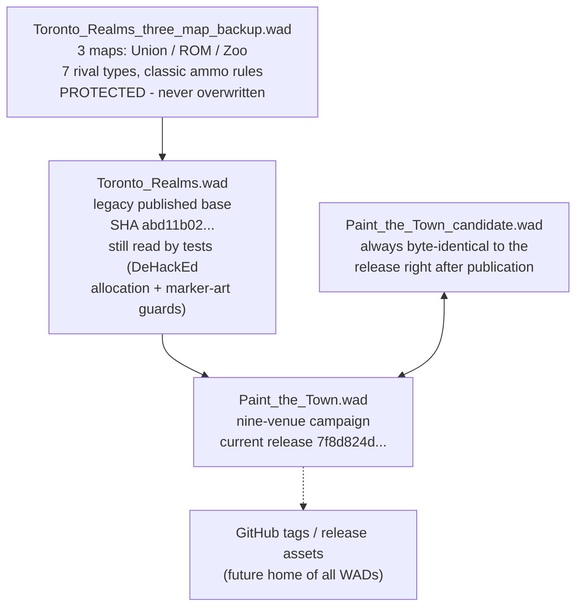

# Project History & Release Lineage

## WAD lineage

Four WADs remain in the workspace (gitignored; distribute via releases):

| File | Role |
| --- | --- |
| `Paint_the_Town.wad` | The published game. |
| `Paint_the_Town_candidate.wad` | Development build; publication requires byte-equality. |
| `Toronto_Realms.wad` | Legacy base release — tests read its DeHackEd/art to guarantee the campaign never collides with inherited allocations. |
| `Toronto_Realms_three_map_backup.wad` | The original 3-map build, protected by the publisher; historical rules documented below. |

## Release checksums

| SHA-256 (first 8) | What it was |
| --- | --- |
| `abd11b02` | Toronto Realms HUD/artwork/venue revision (legacy base). |
| `c322587e` | Early Paint the Town nine-map release. |
| `fb799f63` | Keyed-portal/beam release (18-approach portal verification introduced). |
| `223f2530`, `01996e98`, `2fc2b7f8` | Same-day interim releases, superseded before wide distribution (episode-menu fix, tips/girls/end-flow). |
| **`7f8d824d400373a314763c6ffb8aa477147e0285e909db7335bad5a045db3499`** | **Current**: 2026 polish release — Paint Surge health orb, full stock-pickup/menu/text purge, widescreen presentation, royal portrait, Union Great Hall + idle commuters, static baseball roster, arena scoreboard & gates, Nathan sky rotation, lime message font, 8-direction girl walk. |

Older `previous_*.wad` snapshots were removed from the workspace during the
pre-GitHub cleanup (2026-11-14); from now on, releases live as Git tags.

## Milestones

1. **Three-map Toronto Realms** — Union, ROM, Zoo. Original AI art, 7 rivals,
   paintball weapon reskins, synthesized sounds, per-map music. Preserved
   byte-for-byte as the protected backup.
2. **Nine-map Paint the Town** — the supplied Google-Maps route (ROM →
   Queen's Park → Sankofa → Nathan Phillips → Union → Scotiabank → Rogers →
   Islands → Zoo), 19 rivals, shared-paintball economy, pixel-art overworld,
   portal-key progression, original soundtrack ×9.
3. **Keyed portal gates** (`fb799f63`) — octagonal Portal Key, gold ground
   panel, fairy dust → activation beam, 18-approach native verification.
4. **HD venue art & walkers** — AI panorama skies, baked-lighting wall
   atlases, directional animated NPCs, wandering girls, route tips.
5. **Steam standalone** — Woof!/GZDoom/Freedoom compatibility matrix, smart
   launcher, store assets, Steamworks walkthrough (account verification
   pending at the time of writing).
6. **2026 polish (`7f8d824d`, current)** — see checksum table above; also
   rewrote the Union NPCs from walking pedestrians to idle watch-checking
   commuters, de-aliased animation sampling in verification, and added a
   two-hypothesis widescreen victory matcher.

## Hard-won engine findings

These cost real debugging time — don't rediscover them:

| Finding | Consequence |
| --- | --- |
| KEX renders intermission statistics (Kills/Items/…) with its **engine font**; embedded replacements are ignored. | Documented limitation; cannot fix in WAD data. |
| SBARDEF has **no player-angle condition**. | The HUD mini-map's north arrow is static; no live compass. |
| KEX `A_Turn` takes binary angle units (1073741824 = 90°), not degrees. | Portal beam surveying states. |
| Native puffs get upward velocity **after** their first state. | Paint splats spawn a second zero-velocity child one tic later. |
| KEX **auto-centres** fullscreen patches wider than 320 and *also* applies their left offset. | Widescreen pages (560×200) must use offset 0, or they double-shift. |
| KEX stretches 560-wide end-art across the whole screen; Woof letterboxes. | The finale matcher tests both display hypotheses. |
| `endgame=true` on E1M9 **crashed** KEX at the stats screen. | The finale uses explicit `endpic`/`intertext` instead. |
| KEX skips the ordinary "entering" screen after episode slot 8. | The Islands→Zoo handoff uses an explicit interlude screen. |
| GZDoom 4.14 rejects `Doom version = 2024` DeHackEd. | GZDoom unsupported; Woof! bundled instead. |
| UMAPINFO `episode = clear` + one episode skips the episode menu entirely. | New Game goes straight to skill select. |
| FindTracer needs COUNTKILL momentarily on its target. | Walker anchors gain and immediately shed it; nothing counts as a kill. |
| Doom spawn angles floor to 45° increments; sky texel = (yaw/360)·1024. | World-facing sprite and sky-rotation math. |
| Desktop/GDI capture of exclusive-fullscreen KEX returns black. | Verifiers bind F10 to the engine's own `screenshot` command. |

## Historical three-map rules (preserved backup only)

The backup keeps the original design: threat-based NPC sizing (raccoon 56u →
armour 100u), classic per-weapon ammo, 119 NPC frames, three 32-bar synth
loops (Concourse After Dark / Concrete and Glass / Ravine Circuit), and stock
title/menu music. None of that applies to the current campaign — the current
rules are in [README.md](../README.md) and `assets/Game/` metadata.

## Reference and influence record

- Venue layouts were *informed by* public visitor maps (Union/torontounion.ca,
  ROM museum maps, Toronto Zoo plan) and official architecture pages — no
  photographs, map tiles or commercial artwork are embedded.
- The overworld's cartoon-Toronto direction nods to Scott Pilgrim vs. the
  World: The Game's world map; the artwork is original procedural pixel art.
- Paintball-game design references (NPPL Championship Paintball, Greg
  Hastings series, SUP'AIRBALL equipment) informed lane/bunker design.
- The full annotated reference list (migrated from the retired README.txt):
  - Venue maps: <https://torontounion.ca/eatshop/station-map/>,
    <https://www.rom.on.ca/visit/museum-maps-tours>,
    <https://www.torontozoo.com/plan>
  - Architecture/materials: <https://www.toronto.ca/services-payments/venues-facilities-bookings/booking-city-facilities/union-station/history-of-union-station/>,
    <https://www.rom.on.ca/blogs/building-blocks-rom>,
    <https://www.rom.on.ca/magazine/magnificent-rom-mosaic-ceiling>,
    <https://dac.dk/en/magazine/places/the-crystal-at-the-royal-ontario-museum-612>,
    <https://www.tboake.com/steel/zoo.html>,
    <https://torontosocietyofarchitects.ca/buildings/indo-malayan-pavilion-and-the-african-pavilion-toronto-zoo/>
  - Paintball-game design: <https://www.ign.com/articles/2008/11/24/nppl-championship-paintball-2009-review>,
    <https://ztgd.com/reviews/greg-hastings-paintball-2/>,
    <https://www.metacritic.com/game/greg-hastings-tournament-paintball-maxd/critic-reviews/>,
    <https://www.ign.com/articles/2006/02/08/greg-hastings-tournament-paintball-maxd>,
    <https://www.supairball.com/>,
    <https://www.gunzup.com/league/national-xball-league/>,
    <https://www.combatpursuit.com/combat-games/outdoor-airsoft/>
  - Doom AI behaviour reference: <https://github.com/id-Software/DOOM/blob/master/linuxdoom-1.10/p_enemy.c>
  - Per-asset provenance: `assets/art_sources/*/provenance.json`.
