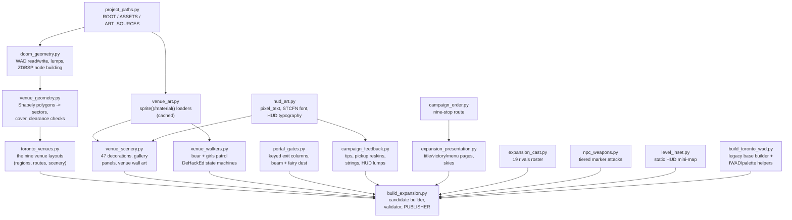
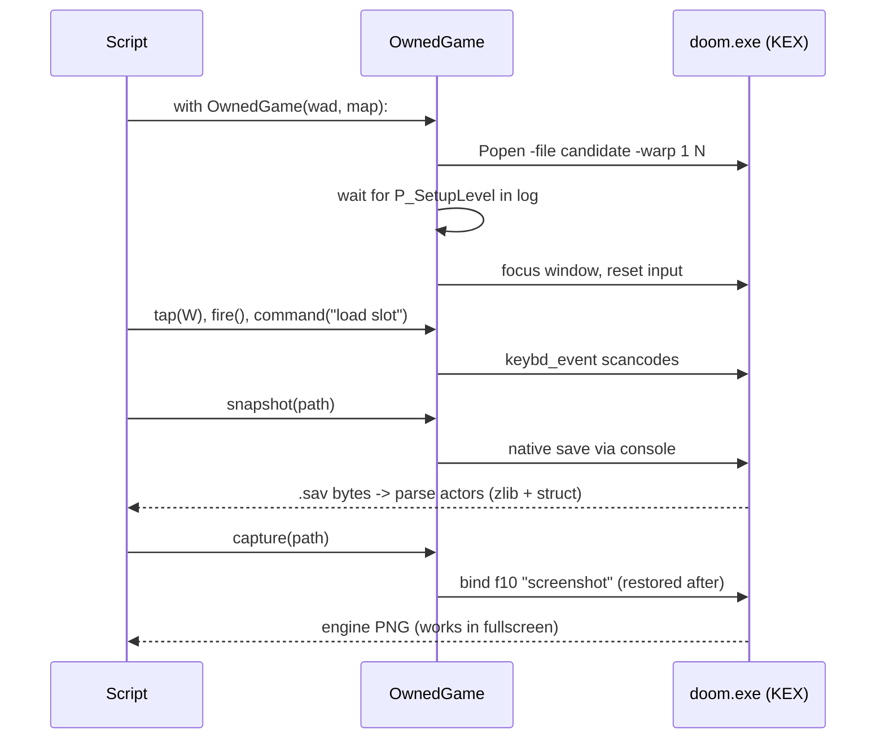

# Script Catalog

Everything lives in `scripts\` — 71 Python modules in four roles:
**core libraries** (content definitions), **builders** (produce artifacts),
**tests** (`test_*.py`, pure Python, fast), and **native verifiers**
(`verify_*.py`, drive the real KEX engine).

Paths resolve relative to the project via `project_paths.py`, never the shell
location. Run tests from the root with
`py -B -m unittest discover -s scripts -q`.

## Core library dependency graph

## Core libraries (content definitions)

| Module | Purpose |
| --- | --- |
| `project_paths.py` | Canonical ROOT/ASSETS/ART_SOURCES paths. |
| `doom_geometry.py` | Classic WAD I/O (`read_wad` is cached by path+mtime), lump packing, ZDBSP invocation. |
| `venue_geometry.py` | Region/cover polygon compiler: walkable checks, radius-aware placement, sector emission. |
| `toronto_venues.py` | The nine venues: footprints, districts, routes, scenery placement, exits, supply alcove. Scale/limitation notes live in its docstrings. |
| `campaign_order.py` | The Google-Maps-derived stop order ending at the Zoo. |
| `venue_art.py` | Cached loaders for prepared sprites/materials. |
| `venue_scenery.py` | 47 nonblocking decorations (animals, fans, roster, commuters…), DeHackEd allocation math, gallery painting walls (RMART1-C + RMKING), venue wall textures (scoreboard, Great Hall…). |
| `venue_walkers.py` | The moving NPCs (arena bear, two wandering girls): fixed-anchor bootstrap + bounded patrol DeHackEd states. |
| `portal_gates.py` | Blue-key exit columns: Boom transfer heights, activation-only animated beam, fairy-dust emitter. |
| `campaign_feedback.py` | Route tips, intro cards, pickup sprite replacements (paint kit + Paint Surge), [STRINGS] messages, SBARDEF HUD. |
| `hud_art.py` | Bitmap typography (`pixel_text`), lime STCFN message font, HUD faces. |
| `expansion_presentation.py` | Widescreen (560×200) TITLEPIC/PTTREADY/TRSTORY/TRVICTRY pages, custom menu graphics (M_*), DEMOLOOP, AI panorama skies. |
| `expansion_cast.py` / `toronto_enemies.py` | The nineteen-rival roster and the legacy seven-type cast. |
| `npc_weapons.py` | Tiered small/medium/large marker attack chains (MBF21). |
| `level_inset.py` | Static per-level HUD mini-map + markers. |
| `expansion_audio.py` / `paintball_audio.py` | Synthesized sound effects (DMX 11025 Hz). |
| `expansion_music.py` / `toronto_music.py` | Original soundtrack synthesis (FFmpeg/libvorbis). |
| `campaign_overworld.py` | Pixel-art Toronto overworld intermission screens. |

## Builders

| Script | Produces |
| --- | --- |
| `prepare_venue_art.py` | Normalized sprite PNGs + `normalization.json` manifest from the AI atlases. |
| `prepare_expansion_art.py` | Cleaned legacy NPC sheets. |
| `build_expansion.py` | **The** candidate builder/validator and checksum-gated publisher (`--publish-kex-verified`, `--publish`). |
| `build_toronto_wad.py` | Legacy three-map/base builder; still supplies IWAD/palette/patch helpers to everything else. |
| `export_game_assets.py` | `assets\Game\` portable export (PNGs, JSON geometry, metadata) for a C++ reimplementation. |
| `build_standalone.py` | `dist\Paint_the_Town_Standalone\` + zip (Woof! + Freedoom + launcher + manifest) and `steam\store_assets\`. |
| `build_mod_previews.py` / `build_expansion_previews.py` | Listing images for mod sites. |
| `probe_ports.py` | Historical port-compatibility matrix runner (Woof vs GZDoom; GZDoom binaries no longer kept). |

## Tests (fast, no game engine)

`test_doom_geometry`, `test_toronto_venues`, `test_venue_geometry`,
`test_venue_revisions`, `test_venue_scenery`, `test_venue_art`,
`test_venue_walkers`, `test_portal_gates`, `test_campaign_feedback`,
`test_level_inset`, `test_campaign_overworld`, `test_campaign_music`,
`test_toronto_music`, `test_toronto_materials`, `test_toronto_enemies`,
`test_toronto_wad`, `test_expansion_cast`, `test_npc_weapons`,
`test_game_assets`, `test_paint_town_capabilities`, `test_expansion_release`
(release/candidate equality + publication-gate safety), `test_standalone`
(package integrity; proves no commercial IWAD bytes can ship).

Conventions:
- tests read the **actual built WAD/exports**, not mocks;
- allocation uniqueness (things/frames/sprites) is asserted globally;
- the legacy three-map tests intentionally read the preserved backup.

## Native verifiers (drive the real engine)

| Script | Scope |
| --- | --- |
| `verify_expansion_runtime.py` | Nine-map startup/music/log gate (publish requirement). |
| `verify_union_stability.py` | Union commuters + Nathan transition + extended soak (publish requirement). |
| `verify_venue_walkers.py` | Bear/girls patrol + save/load gate. |
| `verify_portal_gates.py` | 18 keyed-exit approaches. |
| `verify_visual_fixes.py` | 32 positioned scene captures + world-facing assertions. |
| `verify_campaign_finale.py` | Real final exit → pixel-matched victory. |
| `verify_campaign_overworld.py` | Overworld results/entering screens (+`--introductions`). |
| `verify_revision_scenes.py` | Venue scene captures, HUD stress, baseball save/load. |
| `verify_campaign_feedback.py` | Shared `OwnedGame` harness (window focus, input, engine screenshots, native saves) + ammo/feedback acceptance. |
| `verify_expansion_checkpoints.py` | All-nine keyed-door routing (`--live`). |
| `verify_venue_scenery.py` | Scenery captures + fixture builder used by other verifiers. |
| `verify_level_inset.py`, `verify_npc_weapons.py`, `verify_mallet_art.py`, `verify_hud_capabilities.py`, `verify_embedded_map.py`, `verify_paint_town_capabilities.py`, `verify_campaign_fixture.py` | Focused feature/capability probes (several are historical research kept for reference). |

### How a native verifier works

Key facts a junior dev should know:
- native saves are parsed **byte-level** (`walker_records`): actor x/y/z,
  state, flags, angle live at fixed offsets from the thing-type marker;
- `OwnedGame` refuses to run if any `doom` process exists, and aborts if the
  game loses foreground — never run these while using the machine;
- engine screenshots (not GDI/desktop capture) are the only reliable capture
  path in exclusive fullscreen.
