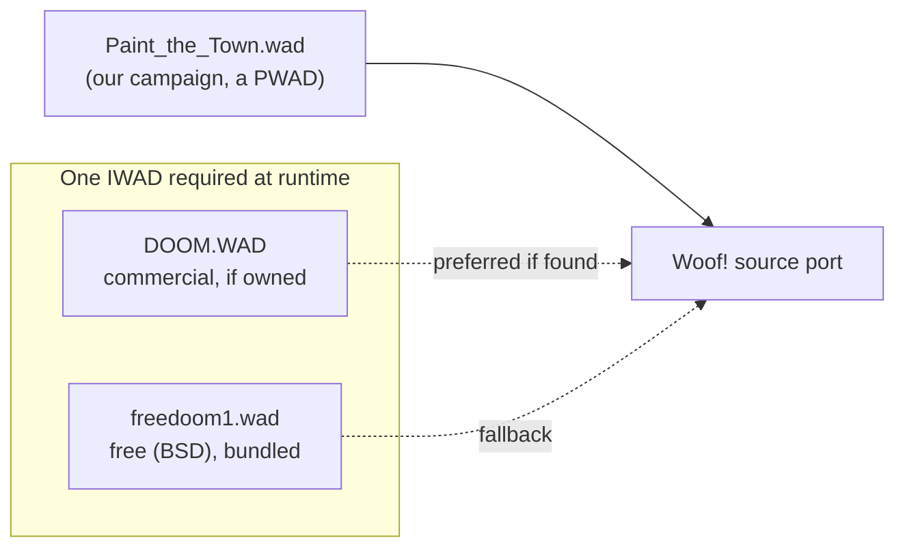
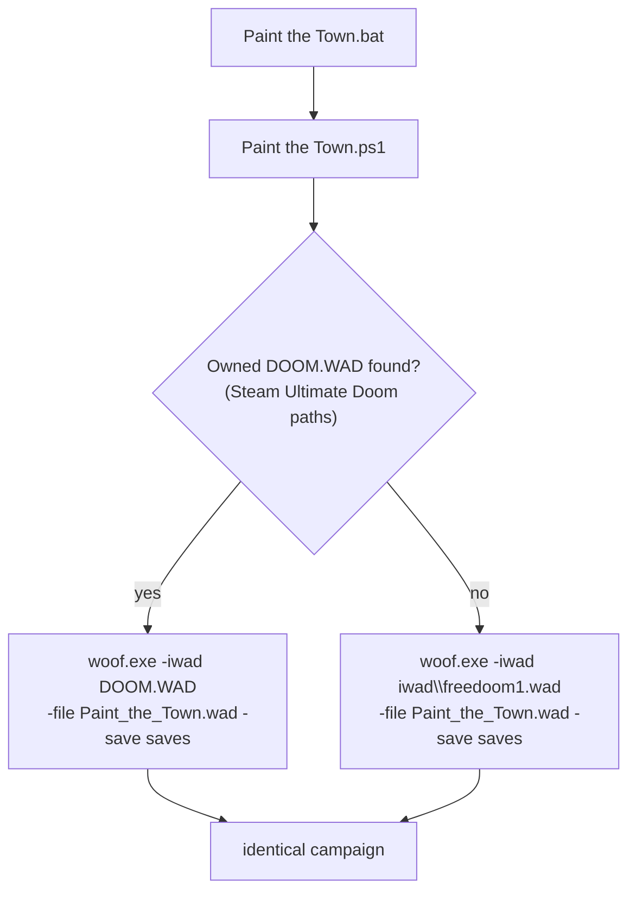

# From DOOM Mod to Standalone Game

Paint the Town began life as a **PWAD** — a mod file loaded on top of a
commercial DOOM installation. It now also ships as a **standalone package**
that runs with zero purchases. This document explains the moving parts for a
developer new to the DOOM ecosystem.

## IWADs, PWADs and why mods need a base game

DOOM separates the engine from its data:

- an **IWAD** ("Internal WAD") is the complete base game data — maps,
  textures, sounds, menus. `DOOM.WAD` is commercial property of id Software;
  owning DOOM legally is owning this file.
- a **PWAD** ("Patch WAD") is a mod: it contains only *replacements and
  additions* and is loaded on top of an IWAD with `-file`.

`Paint_the_Town.wad` is a PWAD. Even though we replace every map, sprite,
menu graphic, sound and song the campaign touches, the engine still demands an
IWAD at startup for the palette and any resource we didn't override. That was
the original "mod" limitation: players needed to own DOOM.

## What Freedoom is (and why it makes us standalone)

[Freedoom](https://freedoom.github.io/) is a complete, **free-software IWAD**
built from scratch by the community under a permissive **BSD licence**. Phase 1
is IWAD-compatible with Ultimate DOOM: same lump names, same map slots, same
palette layout. An engine can't tell the difference.

Because our PWAD replaces essentially all visible content, running it on
Freedoom instead of DOOM.WAD produces a virtually identical game — we verified
this natively, side by side. Bundling `freedoom1.wad` (Phase 1, v0.13.0)
removes the commercial requirement entirely and is store-legal: BSD allows
redistribution with attribution, which ships in `licenses\`.



## Why Woof! ships (engine selection)

The campaign uses the modern **ID24/MBF21** feature set: a custom SBARDEF
status bar, DEMOLOOP title sequence, UMAPINFO episode replacement, and a
DeHackEd patch declaring `Doom version = 2024`. We matrix-tested the realistic
engines:

| Engine | Verdict |
| --- | --- |
| **KEX** (Steam DOOM + DOOM II re-release) | Full fidelity — our primary verification target. But it's commercial and can't be redistributed. |
| **Woof! 16.0.0** | Full ID24 fidelity with both DOOM.WAD *and* Freedoom; GPLv2+, redistributable. **This is what we bundle.** |
| GZDoom 4.14 | **Rejected** — errors on the 2024 DeHackEd spec ("Patch created with unknown DOOM version"); custom actors break. |

Evidence: `runtime_validation\standalone-compat\` (side-by-side captures).

## The standalone package

Built by `py -B scripts\build_standalone.py` into
`dist\Paint_the_Town_Standalone\` (plus a distributable zip):

```
Paint_the_Town_Standalone\
├── Paint the Town.bat / .ps1    smart launcher
├── Paint_the_Town.wad           the campaign (checksum-verified copy)
├── port\woof.exe …              Woof! 16.0.0 (GPLv2+)
├── iwad\freedoom1.wad           Freedoom Phase 1 0.13.0 (BSD)
├── saves\                       portable save folder
├── steam_grid\                  Steam library artwork (cover/wide/hero/icon)
├── licenses\                    GPL, BSD texts + source URLs + provenance
├── README-STANDALONE.txt        player instructions + troubleshooting
└── manifest.json                SHA-256 of every file + release identity
```

`scripts\test_standalone.py` guards the package: correct versions, matching
WAD checksum, launcher integrity, and — crucially — **no commercial IWAD bytes
can ever be packaged**.

### The smart launcher



Both paths were launch-verified natively. Saves and config stay inside the
package folder (portable; nothing touches the user's system).

## Steam

### Local library shortcut (available today)

Steam's "Add a Non-Steam Game" browser filters to `.exe`, so either switch its
file-type dropdown to *All Files* and pick the `.bat`, or add
`port\woof.exe` with launch options (≤255 chars — use relative paths, they
resolve against the shortcut's Start In folder):

```
-iwad ..\iwad\freedoom1.wad -file ..\Paint_the_Town.wad -save ..\saves
```

Artwork for every Steam slot is pre-made in `steam_grid\` (cover 600×900,
wide 920×430, hero 1920×620, icon). The wide/hero images show the full key art
over a blurred fill because Steam crops those slots aggressively.

### Steamworks release (in progress)

Everything repo-side is prepared in `steam\`:

- `app_build.vdf` / `depot_build.vdf` — upload scripts (App/Depot ID
  placeholders pending account verification)
- `store_assets\` — every capsule/hero/logo/screenshot at Valve's exact sizes
- `store_copy.md` — store text + AI disclosure + legal line
- `SETUP-STEAMWORKS.md` — the complete numbered walkthrough (partner signup →
  fee → tax → app creation → steamcmd upload → review)

The store build is the standalone package: customers do **not** need DOOM.
The store page discloses that owning DOOM optionally upgrades the base IWAD.

## History in one sentence

A three-map "Toronto Realms" mod for the Steam KEX re-release grew into the
nine-venue Paint the Town campaign, replaced every stock asset it touched,
proved itself engine-portable, and picked up a free IWAD and a redistributable
engine — at which point the "mod" became a shippable standalone game. Full
lineage: [HISTORY.md](HISTORY.md).
